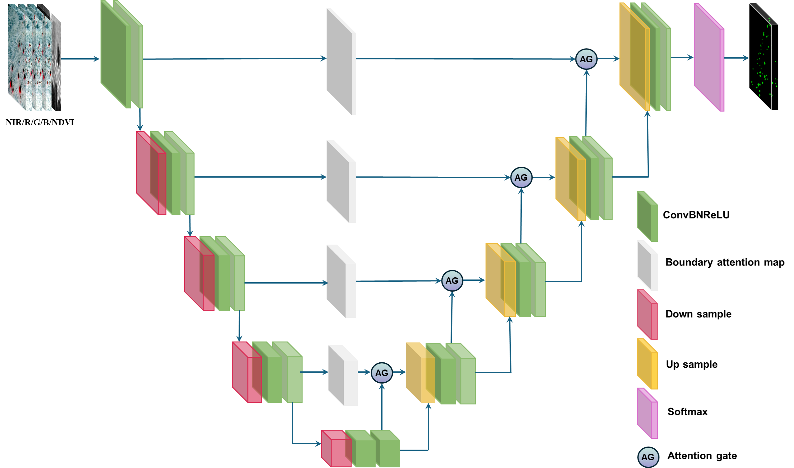

# Neglected dynamics of individual tree growth and mortality in hyper-arid areas

Official PyTorch implementation of the deep learning framework used in the paper:

**Neglected dynamics of individual tree growth and mortality in hyper-arid areas**

This repository provides the code used for detecting individual trees in hyper-arid environments using very high-resolution satellite imagery and deep learning.

The framework is designed to detect sparse tree crowns and analyze tree dynamics in desert ecosystems.

---

# Model Overview

The model is based on an improved **U-Net architecture** designed for detecting sparse individual trees in high-resolution satellite imagery.

Key components include:

- Morphological Attention Module
- Direction Centrality Module
- Attention Gate for skip connections

These modules enhance boundary detection and structural awareness, improving the detection of small and scattered tree crowns.

---

# Model Architecture

Below is the architecture of the proposed model.


---

# Repository Structure

```
code
│
├── data
│ ├── Train
│ │ ├── Train-Image
│ │ └── Train-Mask
│ │
│ ├── Validation
│ │ ├── val-Image
│ │ └── val-Mask
│ │
│ └── Test
│ ├── Test-Image
│ └── Test-Mask
│
├── src
│ └── UNET.py
│
├── train_utils
│ ├── distributed_utils.py
│ ├── train_and_eval.py
│ └── loss
│  └── BCE_TverskyLoss.py
│
├── my_dataset.py
├── transforms.py
├── train.py
├── validation.py
└── predict_stride.py
```


# Environment Setup

Recommended environment:

Python 3.12
PyTorch 2.7

Install dependencies:

pip install -r requirements.txt

---

# Data Preparation

The dataset consists of satellite imagery and manually annotated tree masks.

The data should be organized as follows:

```
data/
├── Train
│ ├── Train-Image
│ └── Train-Mask
│
├── Validation
│ ├── val-Image
│ └── val-Mask
│
└── Test
  ├── Test-Image
  └── Test-Mask
```

Each image should correspond to a mask with the same filename.

Example:

Train-Image
IMG_001.tif

Train-Mask
IMG_001.tif

---

# Training

To train the model:

python train.py


The training script performs:

- dataset loading
- data augmentation
- model training
- validation monitoring
- checkpoint saving

---

# Validation

To evaluate the trained model:

Evaluation metrics include:

- Precision
- Recall
- F1 Score
- Intersection over Union (IoU)
- Dice coefficient
- Overall Accuracy
- Cohen's Kappa

---

# Prediction

To generate predictions for large images:

python predict_stride.py


This script performs prediction using a **sliding window strategy**, allowing large satellite images to be processed efficiently.

---

# Code Availability

The code used in this study is publicly available for research and reproducibility purposes.

---

# Citation

If you use this code in your research, please cite the corresponding paper.

